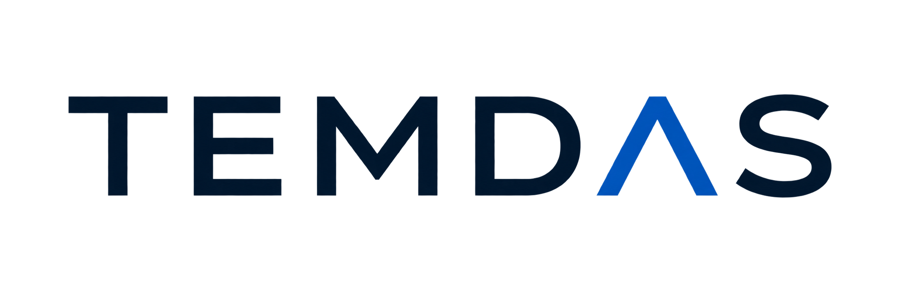

<p align="center">
  
</p>

<p align="center">
  Gestão de demandas, tempo e sprints em uma aplicação web construída com Flutter, Serverpod e Supabase.
</p>

<p align="center">
  <a href="https://temdas.com.br"><strong>Acessar o TEMDAS</strong></a>
  ·
  <a href="docs/roadmap.md">Roadmap</a>
  ·
  <a href="docs/arquitetura.md">Arquitetura</a>
</p>

# TEMDAS

O **TEMDAS** é uma aplicação web para organização de demandas, acompanhamento de tempo e planejamento de sprints.

O projeto começou como uma ferramenta pessoal para controlar trabalho planejado e executado e evoluiu para uma aplicação com backend próprio, autenticação, múltiplos usuários, MFA obrigatório, hierarquia de demandas, gestão de sprints e ambiente de produção.

O foco do produto é manter a gestão do trabalho simples e visual, sem abrir mão de regras de domínio consistentes e rastreabilidade.

## Funcionalidades atuais

### Demandas

- CRUD completo de demandas;
- hierarquia com demandas filhas e descendentes;
- status controlados pelo backend;
- conclusão, reabertura e cancelamento;
- regras de cascata para hierarquia;
- prioridades;
- estimativa de tempo;
- comparação entre tempo estimado e executado;
- visualização em board;
- movimentação por drag-and-drop;
- visualização em lista e modo compacto;
- painel lateral com detalhes, anotações, horas e ações contextuais;
- associação de demandas a sprints.

### Log Time

- registro manual de tempo;
- data e horário do apontamento;
- duração em horas na interface e minutos no domínio;
- descrição/observação do trabalho realizado;
- edição e exclusão de apontamentos;
- visualização diária e semanal em agenda;
- criação de demanda durante o fluxo de lançamento;
- busca de demandas;
- total executado recalculado a partir dos registros persistidos.

### Sprints

- criação e planejamento de sprints;
- início, finalização e cancelamento;
- vínculo entre sprints e demandas por `SprintDemanda`;
- preservação de histórico;
- indicadores de capacidade, estimativa e execução;
- painel lateral com detalhes e ações contextuais;
- associação individual e em lote de demandas;
- navegação integrada entre Demandas e Sprints.

### Autenticação e acesso

- Supabase Auth;
- login por e-mail e senha;
- MFA TOTP obrigatório;
- sessões autenticadas;
- recuperação de senha;
- fluxo de callback no Flutter Web;
- usuário interno provisionado pelo backend;
- exigência de sessão AAL2 nas rotas funcionais;
- convites administrativos;
- controle de acesso administrativo para onboarding de novos usuários.

### Interface

- Flutter Web;
- temas claro e escuro;
- design system centralizado;
- IBM Plex Sans;
- layouts responsivos;
- densidade normal e compacta;
- navegação lateral;
- página pública de apresentação;
- painéis laterais responsivos para Demandas e Sprints.

## Arquitetura

O frontend não acessa os dados de negócio diretamente no Supabase.

```text
Flutter Web
   │
   ├── Supabase Auth
   │      └── autenticação, sessão e MFA
   │
   └── View / Page
          ↓
       ViewModel
          ↓
       Repository
          ↓
       Serverpod Client
          ↓
       Serverpod Backend
          ↓
       Supabase
```

O **Serverpod** é a camada oficial de backend e concentra validações, regras de domínio, transações e acesso aos dados.

No frontend, a separação principal é:

```text
View → ViewModel → Repository → Serverpod Client
```

Arquivos gerados pelo Serverpod não devem ser editados manualmente.

## Stack

| Camada | Tecnologia |
| --- | --- |
| Frontend | Flutter Web / Dart |
| Backend | Serverpod 3.4.11 / Dart |
| Dados | Supabase |
| Autenticação | Supabase Auth |
| MFA | TOTP / AAL2 |
| Hospedagem frontend | Cloudflare Pages |
| Hospedagem backend | Railway |
| E-mail transacional | Resend |
| CI/CD | GitHub Actions |

## Produção

O TEMDAS está publicado em:

**https://temdas.com.br**

A infraestrutura de produção utiliza Cloudflare Pages para o frontend, Railway para o backend Serverpod e Supabase para autenticação e persistência.

O projeto também possui processo documentado de backup externo, restauração isolada e controle de migrations.

## Estrutura do repositório

```text
temdas/
├── app/                         # Flutter Web
├── serverpod/
│   └── temdas_backend/
│       ├── temdas_backend_client/
│       └── temdas_backend_server/
├── docs/                        # Arquitetura, regras e roadmap
└── README.md
```

## Executando localmente

### Pré-requisitos

- Flutter compatível com o projeto;
- Dart;
- Serverpod CLI compatível com o backend;
- acesso a um ambiente Supabase configurado;
- variáveis e secrets locais necessários ao backend.

> Credenciais, tokens, chaves privadas e arquivos de secrets não devem ser versionados.

### Backend

```bash
cd serverpod/temdas_backend/temdas_backend_server
dart run bin/main.dart
```

Por padrão, o ambiente local utiliza:

```text
Serverpod API       8080
Serverpod Insights  8081
Serverpod Web       8082
```

### Flutter Web

Em outro terminal:

```bash
cd app
flutter pub get

flutter run \
  -d web-server \
  --web-hostname 0.0.0.0 \
  --web-port 3000
```

A aplicação fica disponível em:

```text
http://localhost:3000
```

Mais detalhes estão em [docs/setup-serverpod.md](docs/setup-serverpod.md).

## Validação

Frontend:

```bash
cd app
flutter analyze
flutter test
```

Backend:

```bash
cd serverpod/temdas_backend/temdas_backend_server
dart analyze
dart test
```

Alterações em modelos e protocolos Serverpod devem ser acompanhadas de geração e revisão dos artefatos correspondentes:

```bash
serverpod generate
```

Migrations devem ser revisadas e aplicadas de forma controlada.

## Documentação

A documentação versionada é parte da fonte de verdade do projeto.

- [Roadmap oficial](docs/roadmap.md)
- [Arquitetura](docs/arquitetura.md)
- [Escopo da V1](docs/escopo_temdas_v1_atualizado.md)
- [Autenticação com Supabase](docs/autenticacao-supabase.md)
- [Callback de autenticação](docs/auth-callback-flutter.md)
- [Convites administrativos](docs/convites-admin.md)
- [Transições de status](docs/transicoes-status.md)
- [Schema de Sprints](docs/schema-sprints-serverpod.md)
- [Setup do Serverpod](docs/setup-serverpod.md)

Documentos de handoff permanecem no repositório como registro histórico e não substituem o estado atual do código, das migrations e da documentação de domínio.

## Roadmap

O desenvolvimento continua ativo.

Entre as evoluções já registradas no roadmap estão:

- melhorias contínuas de UX e responsividade;
- refinamentos do Log Time;
- evolução de Projetos;
- organizações e equipes;
- membros, papéis e permissões;
- evolução de perfil e recuperação de MFA;
- melhorias operacionais e de infraestrutura.

Outras possibilidades permanecem em avaliação, incluindo:

- timer automático;
- tags e anexos;
- notificações;
- integração com calendário;
- integrações com n8n;
- agentes de IA;
- dashboards avançados;
- histórico persistente de alterações.

Consulte [docs/roadmap.md](docs/roadmap.md) para o estado e a prioridade de cada item.

## Estado do projeto

O TEMDAS está em **desenvolvimento ativo** e já possui ambiente de produção.

As decisões de produto e arquitetura são documentadas antes da implementação, e o roadmap distingue itens concluídos, parciais, aprovados, em avaliação e recorrentes.
